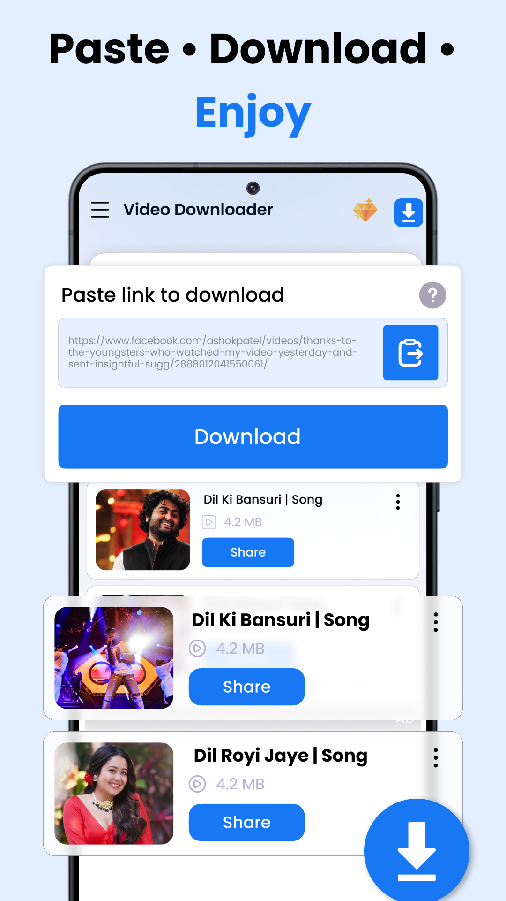
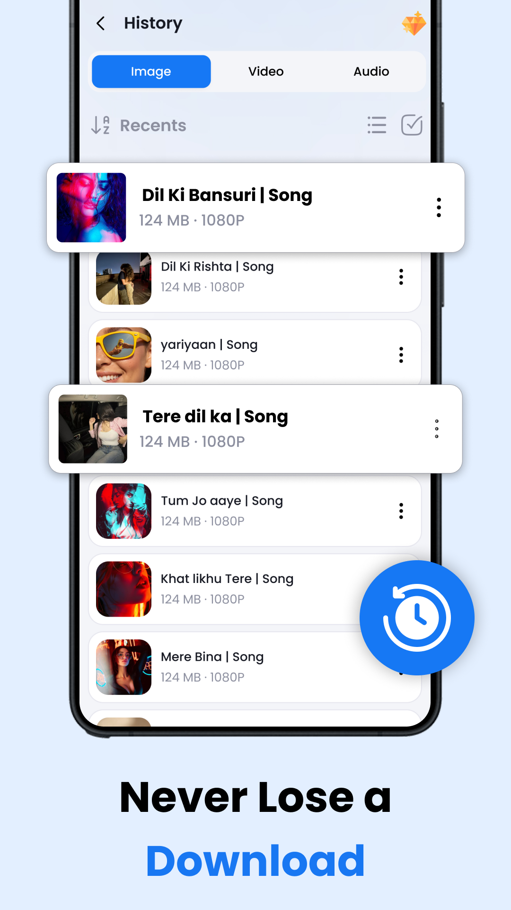
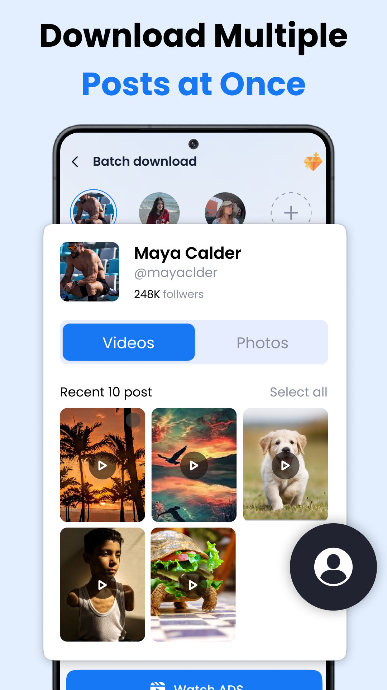
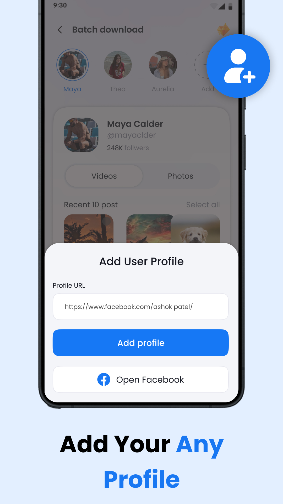
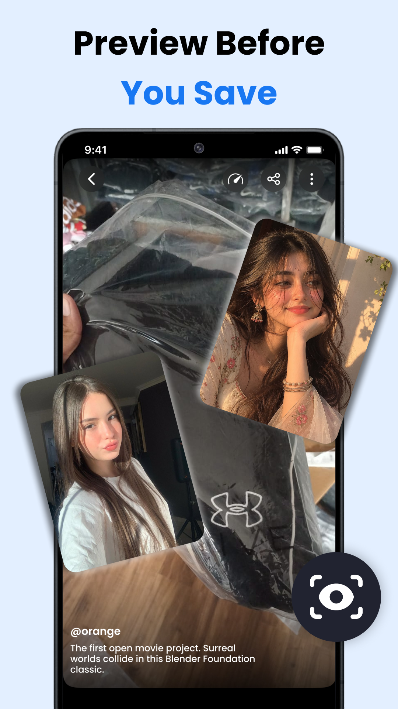
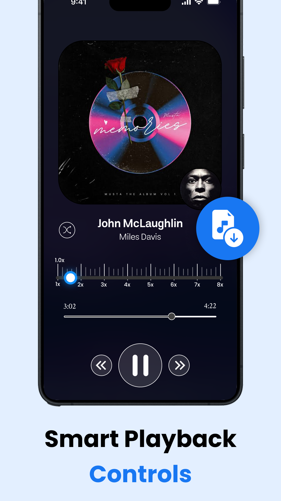
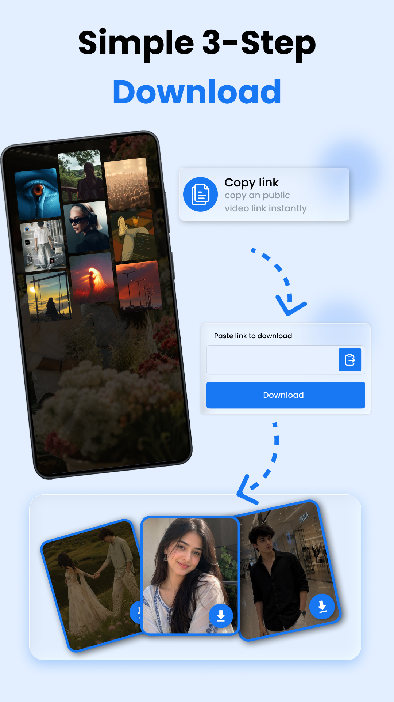
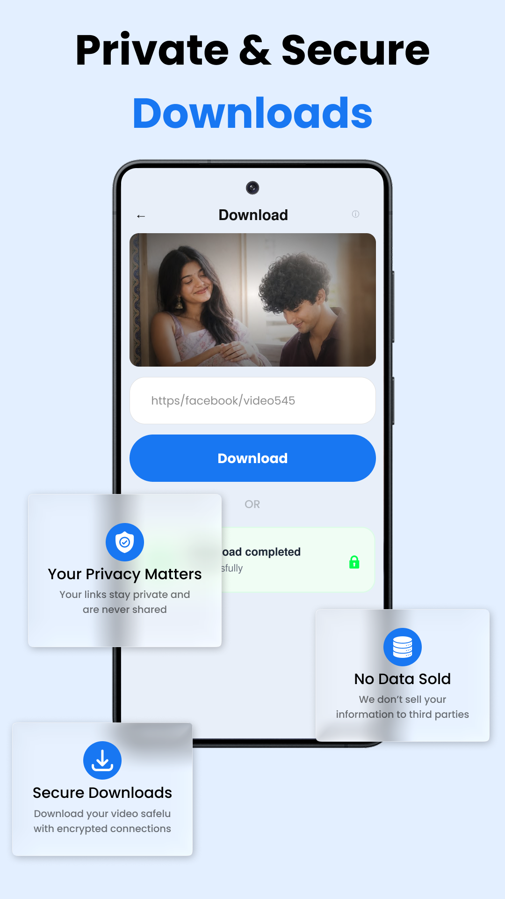

# Facebook Video Downloader – Download Facebook Videos & Reels

### A simple and convenient Facebook Video Downloader for Android.

Download and save your favourite Facebook videos directly to your Android device. This project provides a straightforward way to download supported Facebook videos and Reels for offline viewing.

Whether you're looking for a **Facebook Video Downloader**, **Facebook Reels Downloader**, or **Video Downloader for Facebook**, this Android application makes saving supported Facebook media simple and convenient.

---

## About Facebook Video Downloader

Facebook Video Downloader is an Android application designed to help users download publicly accessible Facebook videos to their devices.

The application focuses exclusively on Facebook media, offering a dedicated downloading experience without unnecessary features from other social media platforms.

Users can copy a Facebook video link, share it with the application, and download supported videos for offline access.

## Features

- **Facebook Video Downloader** – Download supported Facebook videos directly to your device.
- **Facebook Reels Downloader** – Save supported Facebook Reels for offline viewing.
- **Facebook Video Saver** – Keep downloaded videos accessible on your device.
- **Link-Based Downloading** – Download videos using supported Facebook URLs.
- **Share to Download** – Share a Facebook video link directly with the application.
- **Batch Download** – Save multiple media files conveniently.
- **Download Manager** – View and manage downloaded videos.
- **Download History** – Access previously downloaded videos.
- **Built-in Video Player** – Play downloaded videos inside the application.
- **Quick Sharing** – Share saved videos with other applications.
- **Simple User Interface** – Easy-to-use and intuitive downloading experience.
- **Offline Viewing** – Watch downloaded videos without an internet connection.
- **Dark and Light Mode** - Choose your preferred appearance.
- **In-App Purchases**
- **Admob Ads with mediation network**

## How to Download Facebook Videos

1. Open the Facebook application or website.
2. Find the video you want to download.
3. Copy the video link or use the Share option.
4. Open Facebook Video Downloader.
5. Paste or share the copied Facebook video link.
6. Start downloading the video.
7. Find your downloaded video inside the application.

## Supported Media

| Media Type | Support |
|---|---|
| Facebook Videos | Supported |
| Facebook Reels | Supported where available |
| Public Facebook Videos | Supported where accessible |
| Shared Facebook Video Links | Supported where compatible

*Download availability depends on video accessibility, URL format, and Facebook platform restrictions.*

## Screenshots

 
 
 
 
 
 
 
 

🚀 For Sale: Kotlin Android Source Code! 🚀

Looking to kickstart your app project? I’m selling my Kotlin-based Android source code! 💻✨ 

✅ Well-documented  
✅ Easy to customize  
✅ Ready for integration  
Reach out for details and let's bring your app idea to life! 📱💡

#### What You Get

- Full Android App Source Code with AdMob Ads.
- Full Android App Source Code with In-App Purchase.
- Android Project Documentation.
- Project Compile With 16kb page size.
- Projects `minSdk = 24` && `targetSdk = 37`.

## Tech Stack

- **Platform:** Android
- **Language:** Kotlin / Java
- **UI:** Android XML
- **Backend Services:** Firebase
- **Analytics & Stability:** Firebase Analytics, Firebase Crashlytics
- **Notification:** Firebase Push Notifications and OneSignal
- **Monetization:** Google AdMob with Mediation Network
- **Build System:** Gradle

## Project Goals

The goal of this project is to provide a lightweight and dedicated Facebook video downloading experience for Android users.

Key development priorities include:

- Simple video downloading workflow.
- Reliable URL handling and media extraction.
- Efficient download management.
- Smooth offline video playback.
- Clean and maintainable Android architecture.
- Application performance and stability.

## Disclaimer

This project is an independent Android application and is not affiliated with, endorsed by, sponsored by, or officially associated with Facebook or Meta Platforms, Inc.

Facebook is a trademark of Meta Platforms, Inc.

This application is intended for downloading content that users own or have permission to download. Users are responsible for respecting copyright, content ownership, privacy, and applicable platform terms and policies.

---

## GitHub Topics

`facebook` · `facebook-downloader` · `facebook-reels-downloader` · `facebook-video-download` · `facebook-video-downloader` · `facebook-video-downloader-android` · `facebook-video-downloader-app` · `facebook-video-downloader-source-code` · `fb-downloader` · `fb-reels-downloader` · `fb-video-downloader` · `fb-video-saver` · `video-downloader` · `video-downloader-android` · `video-downloader-for-facebook`

---

**Built by AndroidCraft Labs**

*Code Ideas. Craft Impact.*

### Copyright & License

© 2026 Averon. All rights reserved.

This software ("Facebook Video Downloader App") is the exclusive property of Averon. It is licensed, not sold, and can only be acquired directly by contacting Averon. The app is not available through any third-party websites or platforms.

**License Terms:**

1. **Authorized Use**: Upon purchase, you are granted a license to use the app’s source code to create your own application and publish it on the Google Play Store.

2. **No Redistribution of Source Code**: The source code of this app is strictly for personal use only. You are prohibited from sharing, reselling, distributing, or making the source code available to others in any form.

3. **No Unauthorized Sharing**: You may not share, sublicense, or offer the code to any third party, including via websites, forums, or any other means.

4. **No Resale**: Selling or transferring the source code, either modified or unmodified, is strictly prohibited.

5. **Modifications**: You may modify the source code for your personal use in creating your application, but the modified code must also not be shared, sold, or distributed.

6. **Compliance**: By using this software, you agree to adhere to all applicable copyright and licensing laws. Violation of these terms may result in legal action.

For further inquiries or to obtain a license, please contact developer.friendly.box@gmail.com

  

